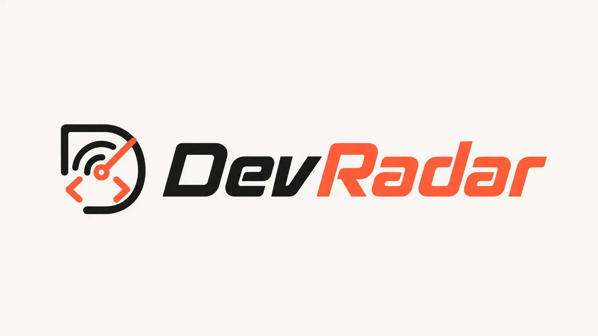

<div align="center">
  
  <h1>DevRadar</h1>
  <p><strong>Open-source developer opportunity intelligence</strong> — online hackathons & free AI offers, with multi-tier verification.</p>

  <p>
    <a href="LICENSE"></a>
    <a href="CONTRIBUTING.md"></a>
  </p>
</div>

---

## What it is

DevRadar aggregates **hackathons / challenges** and **AI free tiers / credits / promos**, then tries to **verify** them against official pages when possible.

| Principle | Meaning |
|-----------|---------|
| **No end-user login** | Browse, filter, bookmark (localStorage), submit URLs without an account |
| **No user API keys** | Visitors never paste OpenAI/X keys into the browser |
| **X is discovery, not truth** | Social posts are Tier-3 signals; official URLs are preferred |
| **Human-in-the-loop** | Admin review queue for publish/reject (Google OAuth, optional) |

This is **not** a claim of perfect accuracy. Listings carry verification status (`verified_active`, `likely_active`, `registration_closed`, …) and prize labels that may say **TBA** when the pool is unknown.

---

## Architecture (short)

```
Browser (React/Vite)  →  FastAPI (/api/v1)  →  PostgreSQL
                              ↓
                     Redis · Celery (fetch queue)
                              ↓
              Connectors: official site, Devpost, Devfolio, MLH, lablab.ai, RSS, X (optional)
```

| Piece | Role in local dev |
|-------|-------------------|
| **Docker Compose** (`infra/compose.yaml`) | Postgres **5434**, Redis **6379**, optional MinIO **9000** — *infra only* |
| **API** (host, `:8000`) | FastAPI via `uv run uvicorn` |
| **Worker** (host) | Celery `fetch` queue — submission review, discovery, rechecks |
| **Frontend** (host, `:5173`) | Vite; proxies `/api` and `/health` to the API |

- **Frontend-only** works with offline mock data; the real catalogue needs the API + Postgres.
- **Celery worker required for automatic submission review**: without a `fetch` worker, community submissions stay queued.
- **Celery beat required for the 3× daily online-hackathon harvest** (Devpost + Devfolio + MLH + lablab.ai → AI review → admin queue; nothing goes public until you approve).
- **Seed demo mode** (recommended first run): no OpenAI / no X keys — load curated JSON into Postgres.
- **Object storage default** is local files under `backend/data/raw` (`OBJECT_STORAGE_BACKEND=local`). MinIO is optional if you switch to `s3`.

---

## Sources

The scheduled harvest reads these public hackathon directories, keeps the online (and hybrid) events and parks them in the admin review queue.

| Source | Access | Open filter | Online signal | Prize | Default |
|--------|--------|-------------|---------------|-------|---------|
| Devpost | public JSON API | `status[]=open,upcoming` | `displayed_location.icon == globe` | yes | on |
| Devfolio | internal JSON API (undocumented) | `filter=application_open,live,upcoming` | `is_online` | no | on |
| DoraHacks | internal JSON API (`/api/v1/hub/hackathons`, undocumented) | `timeline_end >= now` | `venue_form` Virtual or Hybrid | USD/stablecoin only | on |
| Unstop | public JSON API (`/api/public/*`, allowed by robots.txt) | `oppstatus=open` | `region` online or hybrid | USD only (INR kept as text) | on |
| lablab.ai | Next.js RSC payload in the page | `endAt >= now` | `eventType` ONLINE or HYBRID | no | on |
| ETHGlobal | Next.js RSC payload in `/events` | `endTime >= now`, `type == hackathon` | `medium` | no | on |
| TAIKAI | server-rendered `/en/hackathons` page | open cards | Online/Virtual tag only | when shown | on |
| HackQuest | RSC payload in the page only (robots.txt disallows `/api/`) | `status == publish`, not ended | `info.mode` ONLINE or HYBRID | USD/stablecoin only | on |
| Hack2Skill | public JSON list (undocumented) | window now → +1 year | `mode` ONLINE or HYBRID | no | on |
| hackathon.com | server-rendered `/online` cards (day + month; year inferred) | not ended | Online/Hybrid tag | no | on |
| Commudle | public JSON API (`when=future`, cursor paged) | upcoming | `hackathon_location_type` | USD only | on |
| Hack Club | `/api/events/upcoming/` JSON, embedded page data as fallback | upcoming | `virtual` / `hybrid` | no | on |
| MLH | Inertia JSON in the season page | `upcomingEvents` | `formatType` digital or hybrid | no | on |

Order matters: `HARVEST_SOURCES` lists sources in priority order, and an earlier source wins a cross-source duplicate. Leave a source out to switch it off. In-person events are never queued. CAPTCHA- or WAF-gated responses are skipped, never bypassed: the connector marks itself blocked and the next window tries again. Every connector sends the honest `DevRadarBot` user agent.

Not harvested: HackerEarth (its bot protection answers 403; the old fixture-only connector stays for tests), Kaggle (API key required), Gitcoin, Encode Club and AngelHack (no public listing), Akindo (no live events) and Superteam Earn (bounties, not hackathons). dev.events has an RSS feed, but only a handful of its items are hackathons, so it is not seeded; add it yourself with `uv run python scripts/seed_discovery_sources.py --rss "dev.events" https://dev.events/rss.xml --module hackathon` if you want it.

Caps: `HARVEST_DEVPOST_CAP` (20), `HARVEST_SOURCE_CAP` (10 for every other source) and `HARVEST_TOTAL_CAP` (40 per run, shared round-robin). With every source on, raise `HARVEST_TOTAL_CAP` if you want more than about three new events per source per run; each queued event costs one crawl-lane extraction. Hybrid events are queued as hybrid so an admin can judge whether remote participation is real.

**Cross-source corroboration.** The same event often appears on several directories under different URLs. Duplicates are matched on canonical URL, or on normalised title with overlapping dates. The lower-priority copy is not queued, but it is recorded on the winner (`directory.alsoListedOn` in the review snapshot) and counted as an independent source by the verifier's corroboration score.

**Directory dates.** Registration and submission deadlines from the directory fill gaps in the LLM extraction. Where the directory hosts the event page (all sources except Hack Club, hackathon.com and MLH), its dates win a disagreement of more than a day; either way the disagreement is listed in `directory.dateConflicts` and as a `directory_date_conflict:*` warning.

**Change detection.** When a directory that hosts the event page reports a registration or submission deadline that differs by more than a day from a published listing with the same URL, the harvest opens a review item (`directoryChange` in the snapshot, linked to the listing). The listing itself is never edited automatically, and the same move is not flagged twice while its item is open.

**Source health.** `GET /api/v1/admin/sources/harvest-health` reads each source's recent harvest runs and flags `blocked`, `failing` (3 failed runs in a row), `degraded` (partial run), `silent` (found nothing after earlier runs found rows, the usual sign of a changed payload) and `stale` (no successful run in 48 hours). Several of these directory endpoints are undocumented and can change without notice, so check it after a quiet week.

---

## Quick start (full stack)

### Prerequisites

- [Docker Desktop](https://www.docker.com/products/docker-desktop/) (or Docker Engine + Compose)
- [uv](https://docs.astral.sh/uv/) (Python **3.12+**)
- **Node.js 20+** and npm (CI uses **Node 22**)

### Windows (PowerShell)

```powershell
git clone https://github.com/bagusardin25/DevRadar.git
cd DevRadar
.\scripts\dev.ps1
```

Then **three** terminals:

```powershell
# Terminal A — API
cd backend
uv run uvicorn app.main:app --reload --host 0.0.0.0 --port 8000

# Terminal B — UI
npm run dev

# Terminal C — Celery fetch/review worker (--pool=solo required on Windows)
cd backend
uv run celery -A app.worker.celery_app.celery_app worker -Q fetch -l info --pool=solo
# Optional: Terminal D — beat (3× daily harvest + lifecycle + alerts)
# uv run celery -A app.worker.celery_app.celery_app beat -l info
```

### macOS / Linux

```bash
git clone https://github.com/bagusardin25/DevRadar.git
cd DevRadar
chmod +x scripts/dev.sh
./scripts/dev.sh
```

Then either three terminals (same commands as above, **omit** `--pool=solo` on Linux/macOS) or:

```bash
make api       # terminal A
make frontend  # terminal B
make worker    # terminal C
```

| URL | Purpose |
|-----|---------|
| http://localhost:5173/ | App |
| http://127.0.0.1:8000/health/ready | API + Postgres + Redis |

### What bootstrap does

`scripts/dev.ps1` / `scripts/dev.sh` (or `make bootstrap`):

1. `docker compose -f infra/compose.yaml up -d`
2. Creates `backend/.env` from `backend/.env.example` (random local secrets; keeps `LLM_PROVIDER=disabled`)
3. `uv sync --all-extras` + `alembic upgrade head`
4. Seeds demo catalogue + default aggregator sources
5. `npm install` if needed

Refresh catalogue after editing seed data:

```bash
cd backend
uv run python scripts/seed_listings.py --update
uv run python scripts/seed_default_sources.py
```

Optional re-fetch of AI offer official pages (rules; LLM if configured):

```bash
cd backend
uv run python scripts/recheck_listings.py --kind ai_offer --limit 25
```

### Environment templates

| File | Purpose |
|------|---------|
| [`backend/.env.example`](backend/.env.example) | **Development** — copy to **`backend/.env`** (Compose ports, seed-demo) |
| [`backend/.env.production.example`](backend/.env.production.example) | **Production checklist** — set via host secrets; `APP_ENV=production` hardens startup |
| [`.env.example`](.env.example) | Optional frontend Vite vars (`VITE_*`) — root `.env` if needed |

Defaults match Compose (Postgres on host port **5434**). Prefer `localhost` for the app URL and OAuth callback host notes (`localhost` ≠ `127.0.0.1` for cookies).

With `APP_ENV=production` the API **refuses** placeholder secrets and Compose DB passwords, requires HTTPS frontend/OAuth origins, sets **Secure** session cookies, and **disables** `/docs`. Details: [SECURITY.md](SECURITY.md#development-vs-production-configuration).

### Docker notes

- **Day-to-day dev:** Compose for infra only (`127.0.0.1` binds); API/worker/frontend run on the host (as above).
- **Optional MinIO:** `docker compose -f infra/compose.yaml --profile object-storage up -d`
- **API image** (secrets never baked in; non-root multi-stage build):

  ```bash
  docker build -f backend/Dockerfile -t devradar-api:local backend
  docker run --rm -p 127.0.0.1:8000:8000 --env-file backend/.env devradar-api:local
  ```

  Prefer a production env file from `backend/.env.production.example` (not the seed-demo `.env`). See [SECURITY.md](SECURITY.md#docker-build-context--deployment).

### Fetches fail behind a fake-IP proxy

If every fetch fails with `Resolved address blocked for <host>: 198.18.x.x`, a local proxy (Clash, Surge, sing-box TUN) is running in fake-IP DNS mode, which resolves every domain into `198.18.0.0/15`. The SSRF guard blocks that range, so the harvest finds nothing. On a **local dev machine only**, set `FETCH_ALLOW_FAKE_IP_PROXY=true` in `backend/.env`, or switch the proxy to real-IP DNS. Never enable it on a server.

---

## Modes of operation

| Mode | Keys needed | Use case |
|------|-------------|----------|
| **Seed demo** | None (Docker + generated secrets only) | Local try-out, OSS contributors, demos |
| **Ingestion + LLM** | `LLM_API_KEY` (OpenAI-compatible) | Extract structured fields from official pages |
| **X discovery** | `X_BEARER_TOKEN` | Find new candidate URLs (pay-per-use; optional) |
| **Admin review** | Google OAuth + `ADMIN_GOOGLE_EMAILS` | Approve/reject listings, catalogue CRUD |

End users of a **hosted** instance still never need those keys — only the **operator** does.

---

## Features (honest list)

**Public**

- Hackathon catalogue (search, filters, compare, bookmarks)
- AI offer catalogue
- Community **Submit** URL → review queue (AI initial review when worker runs)
- Email alert subscribe (needs operator email provider; default `console`)
- Provenance hints (source tier on cards)

**Operator / admin (behind Google login)**

- Review queue (with AI initial review)
- Catalogue manager (hackathons & AI offers)
- Pipeline viewer
- Sources manager

**Not a production Chrome extension** — the side-panel UI is a **simulator / preview**, not a store package.

---

## CI & local checks

PRs to `main` run [`.github/workflows/ci.yml`](.github/workflows/ci.yml). Locally, after infra is up:

```bash
make check              # Linux/macOS — same lint/build/migrate/test order as CI
# Windows:  .\scripts\check.ps1   or   npm run check:all
```

| CI job | Local equivalent |
|--------|------------------|
| Secret scan (Gitleaks) | — (runs only on GitHub) |
| Frontend (`npm ci` → `npm run check`) | `npm run check` / `make check-frontend` |
| Backend (ruff → migrate → pytest) | `make check-backend` |

Full command matrix: [CONTRIBUTING.md](CONTRIBUTING.md#checks-before-a-pr).

---

## Contributing

See **[CONTRIBUTING.md](CONTRIBUTING.md)** and **[CODE_OF_CONDUCT.md](CODE_OF_CONDUCT.md)**.

Preferred ways to add opportunities:

1. In-app **Submit** (URL → review pipeline)
2. PR against curated seed: `data/manual-collection/seed_listings.json` (not `src/data/mockData.ts`)
3. Connector / docs / bugfix PRs

---

## Security

See **[SECURITY.md](SECURITY.md)**. Never commit `.env` or live API keys.

---

## License

[MIT](LICENSE) — Copyright (c) 2026 DevRadar Contributors
